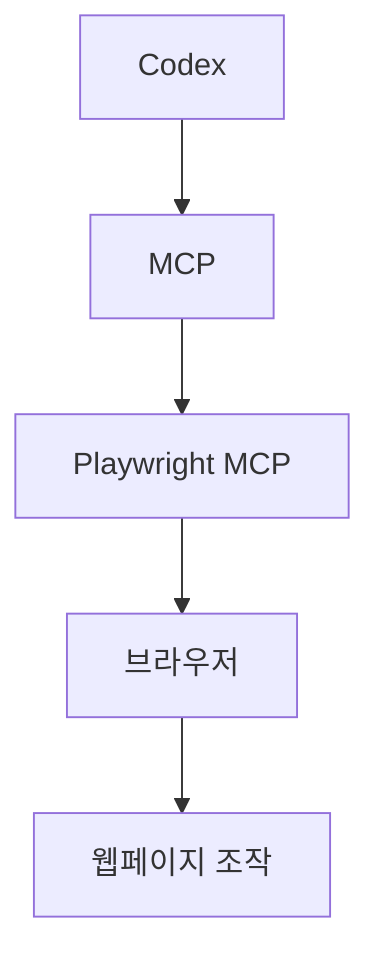
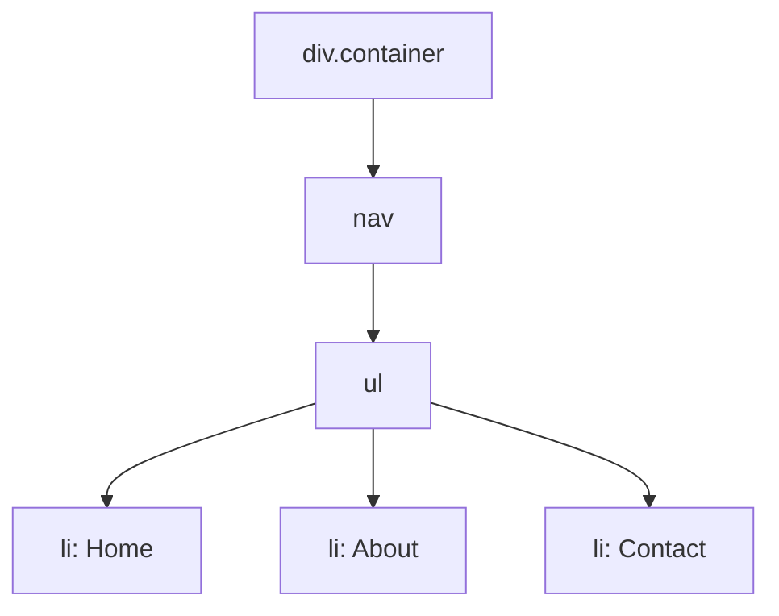
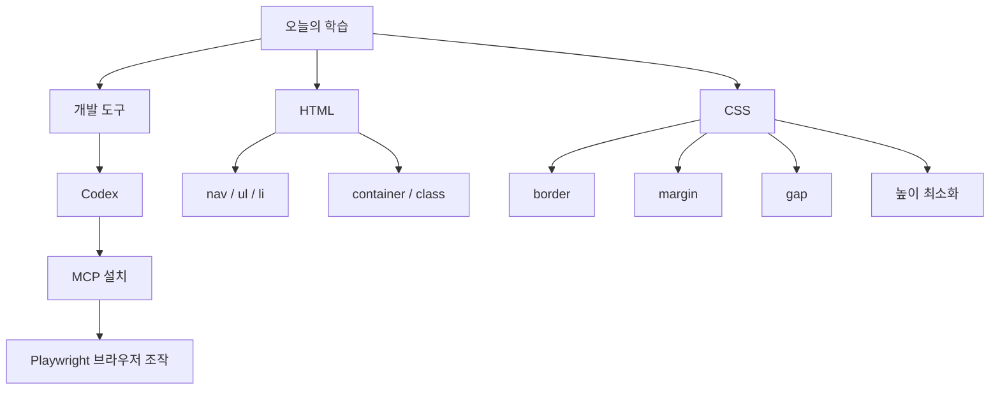

# 오늘의 UI/UX · Frontend 학습 기록

**학습 날짜:** 2026-10-19  
**학습 주제:** Codex, MCP, Playwright 및 HTML/CSS 기초  
**학습 키워드:** #Codex #MCP #Playwright #HTML #CSS #Class #Layout

---

## 1. 오늘의 학습 목표

- Codex 설치 및 사용
- MCP 도구 설치 및 연결
- Playwright MCP를 활용한 브라우저 조작
- HTML의 주요 태그 이해
- CSS의 주요 속성 이해
- 적절한 클래스명과 레이아웃 구성 방법 학습

---

## 2. 핵심 개념 정리

### 개념 1. Codex

- **정의:** 코드 작성 및 개발 작업을 지원하는 AI 코딩 도구
- **사용하는 이유:** 코드 작성, 수정 및 개발 작업을 지원받기 위해 사용

### 개념 2. MCP

- **정의:** AI가 외부 도구와 연결되어 기능을 사용할 수 있도록 하는 프로토콜
- **사용하는 이유:** Codex에서 외부 도구의 기능을 활용하기 위해 사용


### 개념 3. Playwright MCP

- **정의:** AI가 브라우저를 조작할 수 있도록 지원하는 도구
- **사용하는 이유:** 브라우저를 열고 웹페이지를 조작하기 위해 사용

### 개념 4. HTML 주요 태그

| 태그 | 역할 |
|---|---|
| `<nav>` | 내비게이션 영역을 정의 |
| `<ul>` | 순서가 없는 목록 생성 |
| `<li>` | 목록의 각 항목 정의 |
| `container` | 콘텐츠를 감싸는 영역에 자주 사용하는 클래스명 |

**HTML 코드 예시**

```html
<div class="container">
  <nav>
    <ul>
      <li>Home</li>
      <li>About</li>
      <li>Contact</li>
    </ul>
  </nav>
</div>
```

### 개념 5. CSS 주요 속성

| 속성 | 역할 |
|---|---|
| `border` | 요소의 테두리 설정 |
| `margin` | 요소 바깥쪽 여백 설정 |
| `gap` | Flexbox 또는 Grid 등에서 요소 사이 간격 설정 |

**CSS 코드 예시**

```css
.container {
  margin: 20px;
  border: 1px solid black;
}

ul {
  display: flex;
  gap: 16px;
}
```

### 개념 6. 레이아웃 높이 최소화

- **학습 내용:** 웹페이지의 요소가 차지하는 높이를 최대한 적게 사용하기
- **관련 요소:** `margin`, `gap` 등의 여백 설정
- **활용:** 불필요한 여백을 줄여 공간을 효율적으로 구성

---

## 3. 개념 도식화

### 3-1. Codex와 MCP의 관계



### 3-2. HTML 구조



### 3-3. CSS 여백과 테두리 관계

```text
┌──────────── margin ────────────┐
│                                │
│   ┌──────── border ────────┐   │
│   │                        │   │
│   │       콘텐츠           │   │
│   │                        │   │
│   └────────────────────────┘   │
│                                │
└────────────────────────────────┘

margin : 요소 바깥쪽 여백
border : 요소의 테두리
gap    : 요소들 사이의 간격
```

### 3-4. 오늘의 학습 내용 전체 구조



---

## 4. 핵심 요약

- **Codex:** AI 코딩 도구
- **MCP:** AI와 외부 도구를 연결하는 프로토콜
- **Playwright MCP:** 브라우저 조작을 지원하는 도구
- **`nav`:** 내비게이션 영역
- **`ul` / `li`:** 목록(제목)과 목록 항목
- **`container`:** 콘텐츠를 감싸는 영역에 사용하는 클래스명
- **`border`:** 선
- **`margin`:** 바깥쪽 여백
- **`gap`:** 요소 사이 간격
- **클래스명:** 요소의 역할을 알아볼 수 있도록 지정
- **레이아웃:** 불필요한 높이와 여백을 줄여 공간 활용