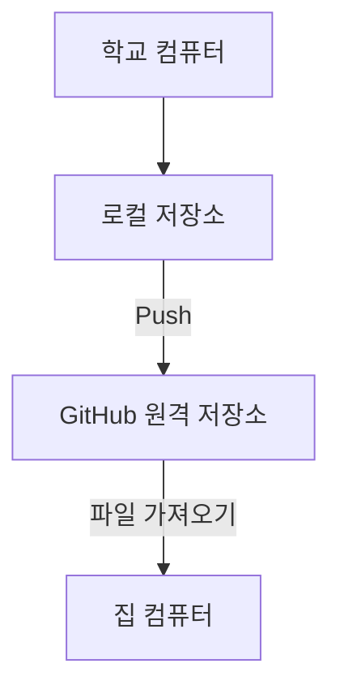
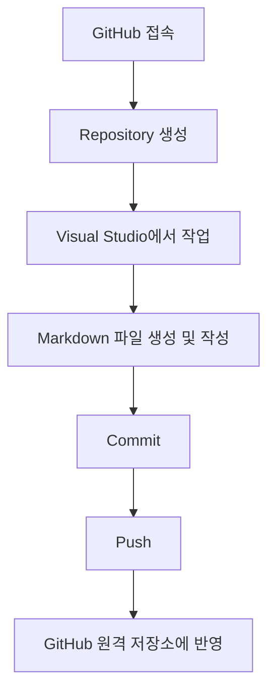
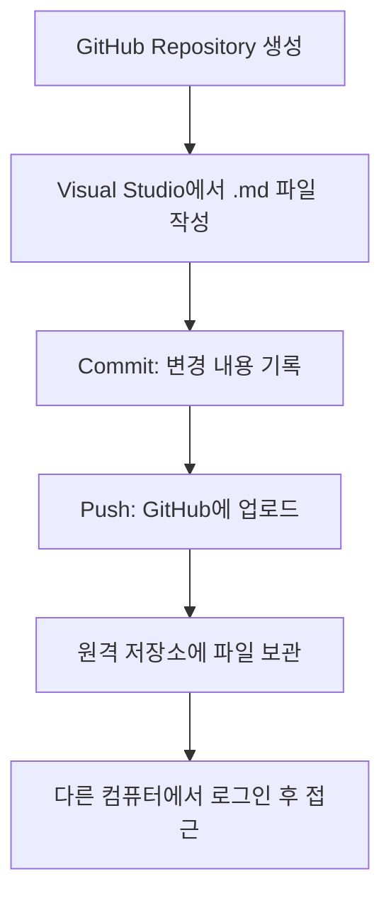

# 오늘의 UI/UX · Frontend 학습 기록

**학습 날짜:** 2026-10-14  
**학습 주제:** GitHub 로컬 및 원격 저장소, Commit과 Push  
**학습 키워드:** #GitHub #Repository #Local #Remote #Markdown #Commit #Push

---

## 1. 오늘의 학습 목표

- 로컬(Local) 저장소와 원격(Remote) 저장소의 차이 이해
- GitHub에서 Repository 생성하기
- Visual Studio에서 Markdown(.md) 파일 작성하기
- Commit과 Push를 사용하여 파일을 GitHub에 업로드하기
- 다른 컴퓨터에서도 GitHub를 통해 파일에 접근하는 방법 이해

---

## 2. 핵심 개념 정리

### 개념 1. 로컬(Local) 저장소

- **정의:** 내 컴퓨터에 있는 저장소
- **사용하는 이유:** 컴퓨터에서 파일을 작성하고 관리하기 위해 사용
- **작동 원리:** 내 컴퓨터에 파일을 저장하고 수정
- **실제 사용 사례:** Visual Studio에서 Markdown(.md) 파일 작성 및 저장

### 개념 2. 원격(Remote) 저장소

- **정의:** GitHub에 있는 저장소
- **사용하는 이유:** 다른 컴퓨터에서도 파일에 접근하고 관리하기 위해 사용
- **작동 원리:** 로컬 저장소의 파일을 GitHub에 업로드하고, 다른 컴퓨터에서 로그인하여 파일에 접근
- **실제 사용 사례:** 학교에서 작성한 파일을 GitHub에 업로드한 후 집에서 가져와 사용

### 개념 3. Repository

- **정의:** 파일을 저장하고 관리하는 저장소
- **사용하는 이유:** 프로젝트 파일을 관리하기 위해 사용
- **작동 원리:** GitHub에서 Repository를 생성하고 파일을 업로드하여 관리
- **실제 사용 사례:** GitHub에서 새로운 Repository 생성

### 개념 4. Commit

- **정의:** 파일의 변경 내용을 저장소에 기록하는 작업
- **사용하는 이유:** 작업한 내용을 기록하기 위해 사용
- **작동 원리:** 변경한 파일의 내용을 로컬 저장소에 기록
- **실제 사용 사례:** Markdown 파일을 작성한 후 Commit 진행

### 개념 5. Push

- **정의:** 로컬 저장소의 Commit을 원격 저장소로 업로드하는 작업
- **사용하는 이유:** 로컬에서 작업한 내용을 GitHub에 반영하기 위해 사용
- **작동 원리:** Commit된 내용을 GitHub 원격 저장소에 전송
- **실제 사용 사례:** Commit 후 Push하여 GitHub에서 파일 확인

---

## 3. 개념 도식화

### 3-1. 로컬 저장소와 원격 저장소 비교

| 구분 | 로컬(Local) | 원격(Remote) |
|---|---|---|
| 저장 위치 | 내 컴퓨터 | GitHub |
| 파일 관리 | 컴퓨터에서 직접 관리 | GitHub에서 관리 |
| 접근 방법 | 해당 컴퓨터에서 접근 | GitHub에 로그인하여 접근 |
| 활용 사례 | 파일 작성 및 수정 | 파일 업로드 및 다른 컴퓨터에서 접근 |

### 3-2. 로컬과 원격 저장소의 관계

### 3-3. GitHub 파일 업로드 과정

### 3-4. Commit과 Push의 차이

| 구분 | Commit | Push |
|---|---|---|
| 역할 | 변경 내용 기록 | 기록한 내용 업로드 |
| 저장 위치 | 로컬 저장소 | 원격 저장소 |
| 목적 | 작업 내용 저장 및 관리 | GitHub에 작업 내용 반영 |

### 3-5. 오늘 배운 내용 전체 흐름

**핵심 정리**

- **Local:** 내 컴퓨터에 있는 저장소
- **Remote:** GitHub에 있는 저장소
- **Repository:** 파일을 관리하는 저장소
- **Commit:** 변경 내용을 기록
- **Push:** Commit한 내용을 GitHub에 업로드

GitHub를 활용하면 파일을 이메일로 따로 옮기지 않아도 다른 컴퓨터에서 접근할 수 있다.