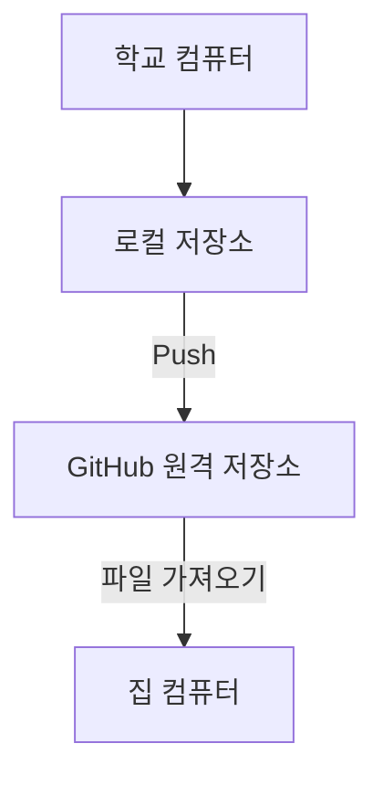
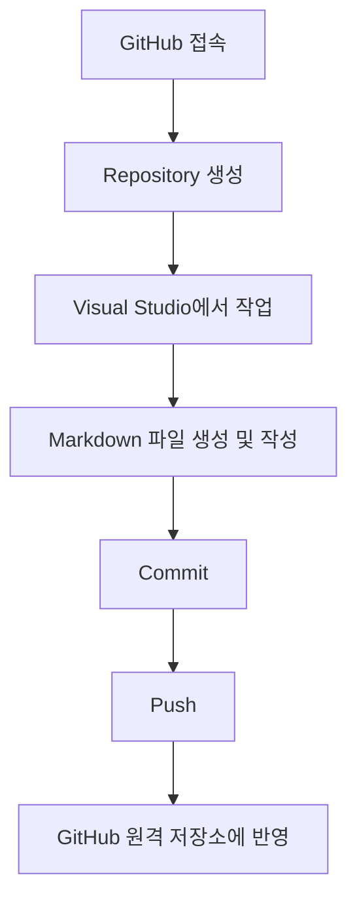
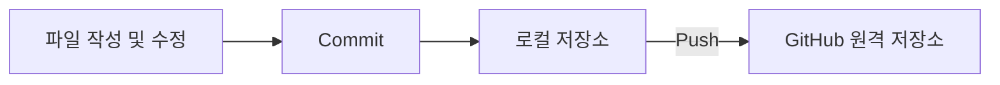
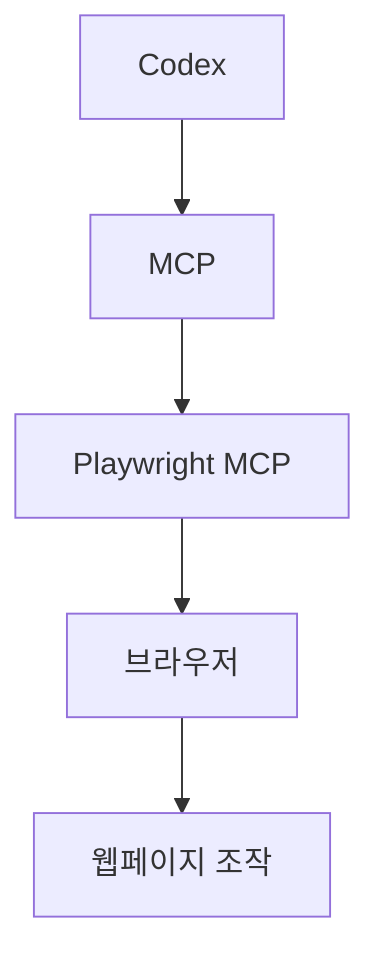
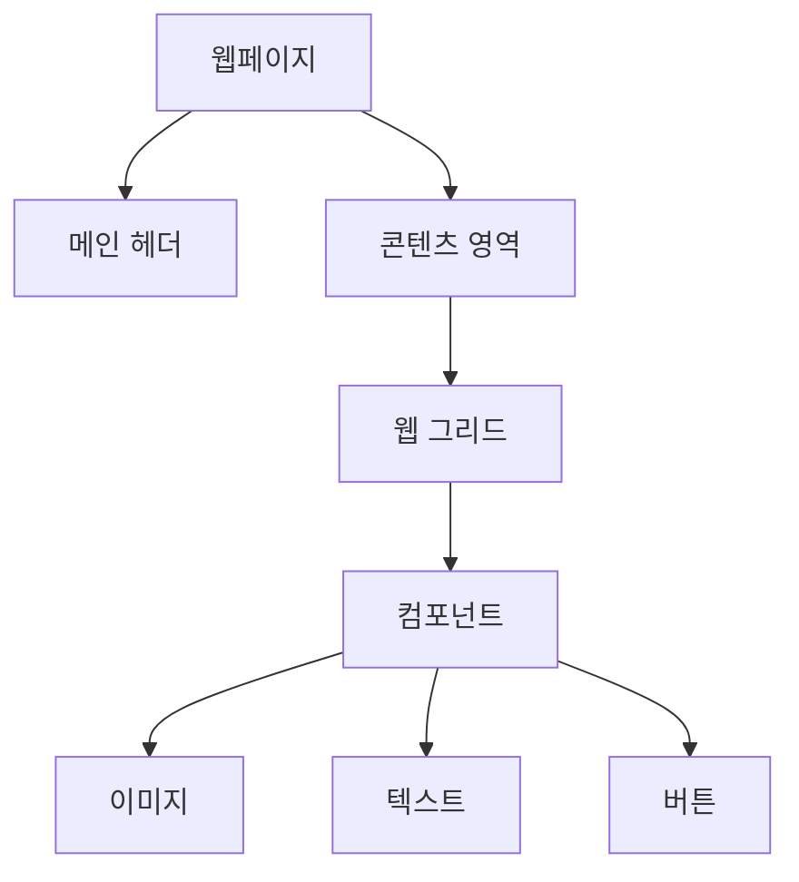
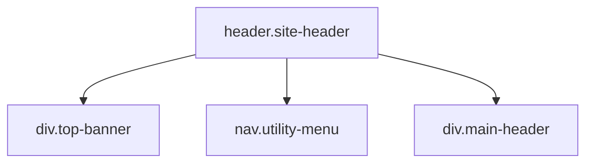

# 10-14 UI/UX · Frontend 학습 기록

**학습 날짜:** 2026-10-14  
**학습 주제:** GitHub 로컬 및 원격 저장소, Commit과 Push  
**학습 키워드:** #GitHub #Repository #Local #Remote #Markdown #Commit #Push

---

## 1. 오늘의 학습 목표

- 로컬(Local) 저장소와 원격(Remote) 저장소의 차이 이해
- GitHub에서 Repository 생성하기
- Visual Studio에서 Markdown(.md) 파일 작성하기
- Commit과 Push를 사용하여 파일을 GitHub에 업로드하기
- 다른 컴퓨터에서도 GitHub를 통해 파일에 접근하는 방법 이해

---

## 2. 핵심 개념 정리

### 개념 1. 로컬(Local) 저장소

- **정의:** 내 컴퓨터에 있는 저장소
- **사용하는 이유:** 컴퓨터에서 파일을 작성하고 관리하기 위해 사용
- **작동 원리:** 내 컴퓨터에 파일을 저장하고 수정
- **실제 사용 사례:** Visual Studio에서 Markdown(.md) 파일 작성 및 저장

### 개념 2. 원격(Remote) 저장소

- **정의:** GitHub에 있는 저장소
- **사용하는 이유:** 다른 컴퓨터에서도 파일에 접근하고 관리하기 위해 사용
- **작동 원리:** 로컬 저장소의 파일을 GitHub에 업로드하고, 다른 컴퓨터에서 로그인하여 파일에 접근
- **실제 사용 사례:** 학교에서 작성한 파일을 GitHub에 업로드한 후 집에서 가져와 사용

### 개념 3. Repository

- **정의:** 파일을 저장하고 관리하는 저장소
- **사용하는 이유:** 프로젝트 파일을 관리하기 위해 사용
- **작동 원리:** GitHub에서 Repository를 생성하고 파일을 업로드하여 관리
- **실제 사용 사례:** GitHub에서 새로운 Repository 생성

### 개념 4. Commit

- **정의:** 파일의 변경 내용을 저장소에 기록하는 작업
- **사용하는 이유:** 작업한 내용을 기록하기 위해 사용
- **작동 원리:** 변경한 파일의 내용을 로컬 저장소에 기록
- **실제 사용 사례:** Markdown 파일을 작성한 후 Commit 진행

### 개념 5. Push

- **정의:** 로컬 저장소의 Commit을 원격 저장소로 업로드하는 작업
- **사용하는 이유:** 로컬에서 작업한 내용을 GitHub에 반영하기 위해 사용
- **작동 원리:** Commit된 내용을 GitHub 원격 저장소에 전송
- **실제 사용 사례:** Commit 후 Push하여 GitHub에서 파일 확인

---

## 3. 개념 도식화

### 3-1. 로컬 저장소와 원격 저장소 비교

| 구분 | 로컬(Local) | 원격(Remote) |
|---|---|---|
| 저장 위치 | 내 컴퓨터 | GitHub |
| 파일 관리 | 컴퓨터에서 직접 관리 | GitHub에서 관리 |
| 접근 방법 | 해당 컴퓨터에서 접근 | GitHub에 로그인하여 접근 |
| 활용 사례 | 파일 작성 및 수정 | 파일 업로드 및 다른 컴퓨터에서 접근 |

### 3-2. 로컬과 원격 저장소의 관계



### 3-3. GitHub 파일 업로드 과정



### 3-4. Commit과 Push의 차이

| 구분 | Commit | Push |
|---|---|---|
| 역할 | 변경 내용 기록 | 기록한 내용 업로드 |
| 저장 위치 | 로컬 저장소 | 원격 저장소 |
| 목적 | 작업 내용 저장 및 관리 | GitHub에 작업 내용 반영 |



GitHub를 활용하면 파일을 이메일로 따로 옮기지 않아도 다른 컴퓨터에서 접근할 수 있다.

# 10-19 UI/UX · Frontend 학습 기록

**학습 날짜:** 2026-10-19  
**학습 주제:** Codex, MCP, Playwright 및 HTML/CSS 기초  
**학습 키워드:** #Codex #MCP #Playwright #HTML #CSS #Class #Layout

---

## 1. 오늘의 학습 목표

- Codex 설치 및 사용
- MCP 도구 설치 및 연결
- Playwright MCP를 활용한 브라우저 조작
- HTML의 주요 태그 이해
- CSS의 주요 속성 이해
- 적절한 클래스명과 레이아웃 구성 방법 학습

---

## 2. 핵심 개념 정리

### 개념 1. Codex

- **정의:** 코드 작성 및 개발 작업을 지원하는 AI 코딩 도구
- **사용하는 이유:** 코드 작성, 수정 및 개발 작업을 지원받기 위해 사용

### 개념 2. MCP

- **정의:** AI가 외부 도구와 연결되어 기능을 사용할 수 있도록 하는 프로토콜
- **사용하는 이유:** Codex에서 외부 도구의 기능을 활용하기 위해 사용


### 개념 3. Playwright MCP

- **정의:** AI가 브라우저를 조작할 수 있도록 지원하는 도구
- **사용하는 이유:** 브라우저를 열고 웹페이지를 조작하기 위해 사용

### 개념 4. HTML 주요 태그

| 태그 | 역할 |
|---|---|
| `<nav>` | 내비게이션 영역을 정의 |
| `<ul>` | 순서가 없는 목록 생성 |
| `<li>` | 목록의 각 항목 정의 |
| `container` | 콘텐츠를 감싸는 영역에 자주 사용하는 클래스명 |

**HTML 코드 예시**

```html
<div class="container">
  <nav>
    <ul>
      <li>Home</li>
      <li>About</li>
      <li>Contact</li>
    </ul>
  </nav>
</div>
```

- 클래스명은 요소의 역할을 알아볼 수 있도록 지정한다.

### 개념 5. CSS 주요 속성

| 속성 | 역할 |
|---|---|
| `border` | 요소의 테두리 설정 |
| `margin` | 요소 바깥쪽 여백 설정 |
| `gap` | Flexbox 또는 Grid 등에서 요소 사이 간격 설정 |

**CSS 코드 예시**

```css
.container {
  margin: 20px;
  border: 1px solid black;
}

ul {
  display: flex;
  gap: 16px;
}
```

### 개념 6. 레이아웃 높이 최소화

- **학습 내용:** 웹페이지의 요소가 차지하는 높이를 최대한 적게 사용하기
- **관련 요소:** `margin`, `gap` 등의 여백 설정
- **활용:** 불필요한 여백을 줄여 공간을 효율적으로 구성

---

## 3. 개념 도식화

### 3-1. Codex와 MCP의 관계



### 3-2. CSS 여백과 테두리 관계

```text
┌──────────── margin ────────────┐
│                                │
│   ┌──────── border ────────┐   │
│   │                        │   │
│   │       콘텐츠           │   │
│   │                        │   │
│   └────────────────────────┘   │
│                                │
└────────────────────────────────┘

margin : 요소 바깥쪽 여백
border : 요소의 테두리
gap    : 요소들 사이의 간격
```

# 10-20 UI/UX · Frontend 학습 기록

**학습 날짜:** 2026-10-20  
**학습 주제:** 웹페이지 구성요소 및 HTML/CSS 기초  
**학습 키워드:** #HTML #CSS #Component #Grid #Image #Padding #BorderRadius #BoxSizing

---

## 1. 오늘의 학습 목표

- 웹페이지를 구성하는 주요 요소 이해
- 메인 헤더, 웹 그리드, 컴포넌트의 개념 이해
- HTML 이미지 태그 사용 방법 학습
- 상대경로와 절대경로의 차이 이해
- CSS의 `padding`, `border-radius`, `box-sizing` 속성 이해

---

## 2. 핵심 개념 정리

### 개념 1. 구성요소와 컴포넌트(Component)

- **구성요소:** 화면을 구성하는 개별 요소
- **컴포넌트:** 화면을 구성하는 요소들을 하나의 기능이나 역할에 따라 묶은 단위
- **사용하는 이유:** 화면의 구조를 구분하고 관리하기 위해 사용
- **실제 사용 사례:** 헤더, 버튼, 메뉴, 카드 등

### 개념 2. 메인 헤더(Main Header)

- **정의:** 웹페이지 상단에 위치하는 주요 영역
- **역할:** 웹사이트의 로고, 메뉴 등 주요 정보를 배치
- **실제 사용 사례:** 홈페이지 상단의 로고 및 내비게이션 메뉴

### 개념 3. 웹 그리드(Web Grid)

- **정의:** 웹페이지의 콘텐츠를 행과 열을 기준으로 배치하는 구조
- **사용하는 이유:** 요소들을 일정한 규칙에 따라 정렬하기 위해 사용
- **실제 사용 사례:** 상품 목록, 사진 갤러리, 카드 레이아웃

### 개념 4. HTML 이미지 태그

**기본 문법**

```html

```

| 속성 | 역할 |
|---|---|
| `` | 이미지를 표시하는 HTML 태그 |
| `src` | 이미지 파일의 위치 지정 |
| `alt` | 이미지를 설명하는 대체 텍스트 |

### 개념 5. 이미지 경로

**상대경로(Relative Path)**

- 현재 파일의 위치를 기준으로 이미지 경로를 지정

```html

```

**절대경로(Absolute Path)**

- 파일의 전체 위치를 기준으로 경로를 지정

```html

```

| 구분 | 상대경로 | 절대경로 |
|---|---|---|
| 기준 | 현재 파일 위치 | 전체 경로 |
| 예시 | `./images/photo.jpg` | `https://example.com/photo.jpg` |
| 특징 | 파일 위치에 따라 달라짐 | 현재 파일 위치와 관계없이 지정 |

### 개념 6. Padding

- **정의:** 박스 안쪽에 여백을 생성하는 CSS 속성
- **역할:** 콘텐츠와 테두리 사이의 공간 설정

```css
.box {
  padding: 20px;
}
```

### 개념 7. Border Radius

- **정의:** 요소의 모서리를 둥글게 만드는 CSS 속성
- **올바른 속성명:** `border-radius`

```css
.box {
  border-radius: 10px;
}
```

### 개념 8. Box Sizing

- **정의:** 요소의 너비와 높이를 계산하는 기준을 설정하는 CSS 속성
- **`box-sizing: border-box`:** 지정한 너비와 높이 안에 `padding`과 `border` 크기를 포함

```css
.box {
  width: 200px;
  padding: 20px;
  border: 2px solid black;
  box-sizing: border-box;
}
```

---

## 3. 개념 도식화

### 3-1. 웹페이지 구성요소



### 3-2. 웹 그리드 구조

```text
┌───────────────────────────────┐
│           메인 헤더            │
├─────────┬─────────┬───────────┤
│ 카드 1  │ 카드 2  │ 카드 3    │
├─────────┼─────────┼───────────┤
│ 카드 4  │ 카드 5  │ 카드 6    │
└─────────┴─────────┴───────────┘
```

### 3-3. Padding 구조

```text
┌────────────── Border ──────────────┐
│                                    │
│       Padding (안쪽 여백)           │
│                                    │
│       ┌──────────────────┐         │
│       │     Content      │         │
│       └──────────────────┘         │
│                                    │
└────────────────────────────────────┘
```

### 3-4. Border Radius 비교

```text
border-radius: 0;       border-radius: 12px;

┌──────────────┐         ╭──────────────╮
│              │         │              │
│     BOX      │         │     BOX      │
│              │         │              │
└──────────────┘         ╰──────────────╯
```

### 3-5. Box Sizing 비교

| 구분 | `content-box` | `border-box` |
|---|---|---|
| 기본값 여부 | 기본값 | 직접 지정 |
| width 기준 | 콘텐츠 너비 | 테두리까지 포함한 너비 |
| padding | 지정 너비에 추가 | 지정 너비 안에 포함 |
| border | 지정 너비에 추가 | 지정 너비 안에 포함 |

**예시: `width: 200px`, `padding: 20px`, `border: 2px`**

```text
content-box
┌─────────────────────────────┐
│ border + padding + content  │
└─────────────────────────────┘
실제 전체 너비: 244px

border-box
┌────────────────────────┐
│ border + padding +     │
│ content                │
└────────────────────────┘
실제 전체 너비: 200px
```

# 10-21 UI/UX · Frontend 학습 기록

**학습 날짜:** 2026-10-21  
**학습 주제:** HTML 시맨틱 구조, CSS 선택자, 레이아웃 및 아이콘 활용  
**학습 키워드:** #HTML #CSS #ID #Class #Hover #Flexbox #ObjectFit #GoogleFonts #SemanticHTML

---

## 1. 오늘의 학습 목표

- HTML의 `id`, `span`, `h`, `p` 태그 이해
- CSS 선택자와 마우스 상호작용 학습
- Flexbox를 활용한 요소 크기 조절
- 이미지 크기 및 잘림 처리 방법 이해
- 웹 표준에 맞는 헤더 구조 설계
- Google Fonts 아이콘 사용 및 크기 조절

---

## 2. 핵심 개념 정리

### 개념 1. HTML 태그

| 태그 | 역할 | 특징 |
|---|---|---|
| `<span>` | 인라인 요소를 묶음 | 텍스트나 아이콘에 스타일 적용 |
| `<h1>`~`<h6>` | 제목 표시 | 숫자가 작을수록 상위 제목 |
| `<p>` | 문단 표시 | 문장이나 문단을 묶을 때 사용 |
| `<a>` | 링크 연결 | `href` 속성으로 이동할 주소 지정 |

**아이콘에 span 사용 예시**

```html
<a href="https://google.com">
  <span class="material-symbols-outlined">
    home
  </span>
</a>
```

- `<span>`으로 아이콘 표시
- `<a>`로 외부 링크 연결

### 개념 2. ID 선택자와 Class 선택자

| 구분 | ID | Class |
|---|---|---|
| HTML 속성 | `id="header"` | `class="header"` |
| CSS 선택자 | `#header` | `.header` |
| 사용 횟수 | 한 문서에서 고유하게 사용 | 여러 요소에 재사용 가능 |
| 우선순위 | Class보다 높음 | ID보다 낮음 |

```html
<div id="header" class="container">
  Header
</div>
```

```css
#header {
  background: gray;
}

.container {
  padding: 20px;
}
```

**핵심:** ID는 한 HTML 문서에서 같은 값을 중복하지 않도록 사용하며, CSS 선택자에서는 `#`으로 불러온다.

### 개념 3. Cursor와 Hover

**`cursor: pointer;`**

- 마우스 커서를 손가락 모양으로 변경
- 클릭 가능한 요소를 표현할 때 사용

**`:hover`**

- 마우스를 요소 위에 올렸을 때 스타일 변경

```css
.button {
  cursor: pointer;
}

.button:hover {
  background-color: gray;
}
```

### 개념 4. Object-fit

**`object-fit: cover;`**

- 이미지 원본 비율을 유지
- 이미지가 박스를 가득 채우도록 확대 또는 축소
- 박스를 벗어나는 부분은 잘림
- 기본적으로 중앙을 기준으로 배치

```css
.image {
  width: 300px;
  height: 200px;
  object-fit: cover;
}
```

### 개념 5. Flex-grow와 Flex-basis

| 속성 | 역할 |
|---|---|
| `flex-grow: 1;` | 남는 공간을 차지하도록 요소를 확장 |
| `flex-basis: 0;` | 요소의 기본 크기를 0으로 설정하여 공간 분배 계산 |

```css
.item {
  flex-grow: 1;
  flex-basis: 0;
}
```

- 부모 요소에 `display: flex;`가 필요
- 두 속성을 함께 사용하면 요소들이 사용 가능한 공간을 비율에 따라 나누기 쉬움

### 개념 6. 버튼 Normalize

- 브라우저마다 다를 수 있는 버튼의 기본 스타일을 초기화하거나 통일하는 작업

```css
button {
  border: none;
  background: none;
  padding: 0;
  cursor: pointer;
}
```

### 개념 7. Border-radius와 Overflow

- 앞서 배운 `border-radius`와 `overflow: hidden;`을 함께 사용하면 둥근 모서리 밖으로 넘치는 이미지 부분이 잘림

```css
.image-box {
  border-radius: 16px;
  overflow: hidden;
}

.image-box img {
  width: 100%;
  display: block;
}
```

### 개념 8. Google Fonts / Material Symbols

- Google Fonts에서 제공하는 아이콘 사용
- 다양한 웹 인터페이스에서 활용 가능
- 상업적 이용도 가능한 오픈소스 라이선스로 제공됨

**아이콘 사용 예시**

```html
<span class="material-symbols-outlined">
  search
</span>
```

**아이콘 크기 조절**

```css
.material-symbols-outlined {
  font-size: 32px;
}
```

- 폰트 형태의 Material Symbols는 일반적으로 `font-size`로 크기 조절 가능
- 일부 아이콘은 CSS 우선순위 또는 라이브러리 설정 때문에 크기 조절이 바로 적용되지 않을 수 있음

**수업 메모:** 아이콘 링크에서 `200` 뒤의 `&`부터 삭제하면 모든 아이콘이 나온다고 학습함.

**확인 필요:** 이 내용은 사용한 Google Fonts URL과 파라미터에 따라 달라짐. `&` 이후를 삭제하는 것이 모든 아이콘을 표시하는 공통 규칙은 아님.

---

## 3. 개념 도식화

### 3-1. HTML 시맨틱 구조

**질문:** `top-banner`, `utility-menu`, `main-header`를 웹 표준에 맞게 어떻게 묶을까?

세 영역이 모두 웹사이트 상단 헤더에 속한다면 `<header>`를 상위 태그로 사용할 수 있다.

```html
<header class="site-header">
  <div class="top-banner"></div>

  <nav class="utility-menu"></nav>

  <div class="main-header"></div>
</header>
```



- `<header>`: 페이지 상단의 소개 및 탐색 영역
- `<nav>`: 내비게이션 링크 영역
- `<div>`: 별도의 시맨틱 의미가 없는 일반 영역

단, `top-banner`가 실제 광고나 독립적인 콘텐츠인 경우에는 용도에 맞는 구조를 별도로 고려해야 함.

### 3-2. 이미지 자르기

```text
원본 이미지
┌────────────────────────┐
│                        │
│         이미지         │
│                        │
└────────────────────────┘
            ↓
 object-fit: cover
            ↓
╭────────────────╮
│  가운데 기준    │
│  이미지 채우기  │
╰────────────────╯

박스 비율에 맞지 않는 이미지 영역은 잘림
```

### 3-3. Flexbox 공간 분배

```text
부모 컨테이너
┌────────────────────────────┐
│          display: flex     │
├─────────┬─────────┬────────┤
│ Item 1  │ Item 2  │ Item 3 │
└─────────┴─────────┴────────┘

각 Item:
flex-grow: 1;
flex-basis: 0;

→ 동일한 조건의 요소들이 공간을 균등하게 분배
```
모나미 모작 — 새로 배운 HTML/CSS 코드 정리
비교 기준: 이전 마켓컬리 와이어프레임 실습(index.html, style.css, 후속 버전)과 이번 모나미 실습(index(2).html, style(2).css). 이미 익힌 기본적인 display: flex, gap, margin, padding, border-radius 설명은 생략하고 새로 등장했거나 사용 방식이 달라진 항목을 정리했다.

1. HTML에서 새로 사용한 코드
1-1. <a> — 하이퍼링크
<a title="facebook" target="_blank" href="https://www.facebook.com/monami1960">
    
</a>
코드	기능	사용 이유
<a>	클릭할 수 있는 링크	SNS 아이콘에서 외부 사이트로 이동
href	이동 주소	연결할 사이트 지정
target="_blank"	새 탭 열기	현재 페이지를 유지하고 SNS 방문
title	보조 설명	링크 정보 제공


- 기존과 다른 점: 기존에는 아이콘을 표시하는 데 집중했지만 이번에는 링크로 실제 이동할 수 있게 했다.
- 참고: 외부 링크에는 rel="noopener noreferrer"를 함께 사용할 수 있다.
1-2. <footer> — 하단 영역
<footer>
    <div class="con">하단</div>
</footer>
- 페이지나 섹션의 하단 정보를 나타내는 시맨틱 태그.
- 사용 이유: 상단 header, 본문 main, 하단 footer를 의미에 따라 구분하기 위해서다.
- 현재 파일은 실제 푸터 내용을 넣기 전의 틀만 만들었다.
1-3. Emmet 축약 문법
ul>li*3>a>img
아래 HTML 구조를 빠르게 생성하는 VS Code의 Emmet 문법이다.
<ul>
    <li><a href=""></a></li>
    <li><a href=""></a></li>
    <li><a href=""></a></li>
</ul>
- >: 자식 요소 생성
- *3: 같은 요소 3개 생성
- 사용 이유: SNS 목록처럼 반복되는 구조를 빠르게 작성하기 위해서다.
2. CSS에서 새로 사용한 코드
2-1. text-decoration: none — 링크 밑줄 제거
a {
    color: inherit;
    text-decoration: none;
}
- color: inherit: 부모의 글자색을 상속.
- text-decoration: none: 링크의 기본 밑줄 제거.
- 사용 이유: HOME, SITE MAP, CONTACT US 메뉴를 일반 메뉴 텍스트처럼 보이게 하려고 사용했다.
2-2. display: block — 이미지의 표시 방식
img {
    display: block;
    background-color: #f1f1f1;
}
- 이미지가 블록 요소처럼 배치된다.
- 인라인 이미지 아래에 생길 수 있는 글자 기준선 여백을 없애는 데 도움이 된다.
- background-color는 이미지 영역에 연한 회색 배경을 준다. 이미지가 불투명하면 배경이 가려질 수 있다.
2-3. ::after + content — 메뉴 구분선 추가
.topmenu > ul > li:nth-child(1)::after,
.topmenu > ul > li:nth-child(2)::after {
    content: "|";
    font-size: 8px;
}
결과: HOME | SITE MAP | CONTACT US
코드	의미
:nth-child(1)	첫 번째 자식 선택
:nth-child(2)	두 번째 자식 선택
::after	선택 요소의 끝에 가상 요소 생성
content: "|"	가상 요소에 | 문자 표시
font-size: 8px	구분선 문자 크기 조절


- 사용 이유: HTML에 | 문자를 직접 넣지 않고 CSS로 구분선을 만들기 위해서다.
- 마지막 CONTACT US 뒤에는 구분선이 필요 없으므로 첫 번째와 두 번째 항목에만 적용했다.
2-4. rgba() — 투명도 있는 색상
footer {
    background-color: rgba(0, 0, 0, 0.2);
}
- rgba(빨강, 초록, 파랑, 알파) 순서로 입력한다.
- 마지막 0.2는 불투명도 20%를 의미한다 (0은 완전 투명, 1은 완전 불투명).
- 사용 이유: 하단에 연한 반투명 검정 배경을 적용하려고 사용했다.
2-5. transparent — 투명한 배경
button {
    background-color: transparent;
}
- 버튼 배경색을 투명하게 만든다.
- 이전 실습의 background: none과 이 상황에서 보이는 효과는 유사하지만, background는 여러 배경 관련 속성을 다루는 축약 속성이다.
2-6. border-bottom — 아래쪽 선만 지정
header {
    border-bottom: 1px solid #eaeaea;
}
- border와 달리 아래쪽에만 테두리를 만든다.
- 사용 이유: 상단 헤더와 본문 사이에 구분선 하나를 만들기 위해서다.
3. 기존 코드와 사용 방식이 달라진 부분
3-1. 공통 컨테이너 .con
.con {
    width: 1400px;
    padding-left: 20px;
    padding-right: 20px;
    display: flex;
    margin-left: auto;
    margin-right: auto;
}
- 이전 마켓컬리 실습에서는 width: 1050px이었지만 이번에는 1400px이다.
- 좌우 padding: 20px을 추가해 내부 콘텐츠가 가장자리에 붙지 않게 했다.
- 주의: 현재 파일에는 .con에 box-sizing: border-box가 없어서 바깥 너비는 1440px이다.
3-2. 중첩 Flexbox로 역할 분리
.utmenu {
    display: flex;
    justify-content: space-between;
    height: 58px;
}

.link {
    display: flex;
    align-items: center;
}

.sns > ul {
    display: flex;
    gap: 8px;
}
- .utmenu: 왼쪽 그룹과 오른쪽 메뉴를 양 끝에 배치.
- .link: 언어 버튼과 SNS 아이콘 묶음을 가로로 배치.
- .sns > ul: SNS 아이콘 세 개를 가로로 배치.
- 사용 이유: 부모마다 서로 다른 정렬 역할을 맡기기 위해서다.
4. 현재 코드에서 점검할 부분
위치	점검 내용
.con	width: 1400px에 좌우 패딩 각 20px이 더해져 바깥 너비 1440px
.topmenu > ul > li	gap: 20px이 링크와 ::after 구분선 사이에도 적용됨
TOP 메뉴 링크	href="#"는 실제 목적지가 없는 임시 링크
SNS 링크	새 탭 외부 링크에 rel="noopener noreferrer" 고려 가능
.top-bar, main, footer	실제 콘텐츠를 넣기 전 임시 문구·디자인이 남아 있음


5. 빠른 복습표
코드	기억할 핵심
<a href="...">	다른 페이지로 이동하는 링크
target="_blank"	링크를 새 탭으로 열기
title	링크 등의 보조 설명
<footer>	하단 영역을 나타내는 시맨틱 태그
ul>li*3>a>img	Emmet으로 반복 HTML 빠르게 생성
text-decoration: none	링크의 밑줄 제거
display: block	블록 요소처럼 표시
::after	요소 끝에 가상 요소 만들기
content	가상 요소에 표시할 내용 설정
rgba()	투명도가 포함된 색상 지정
transparent	투명한 배경색
border-bottom	요소 아래쪽에만 테두리 만들기


이번 복습 우선순위: ::after와 content 조합 → 중첩 Flexbox의 각 부모 역할 → <a> 링크 속성.